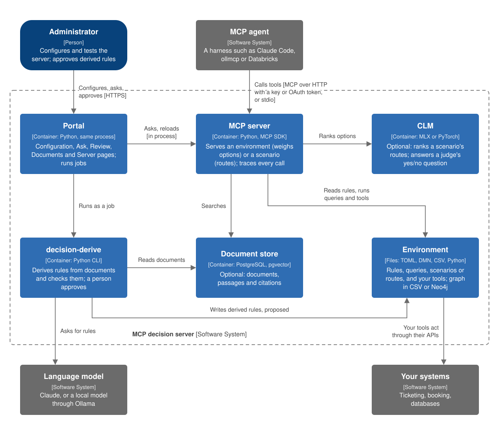

# MCP decision server

An MCP server framework that gives agents trustworthy decisions from your own rules and data.

**A framework, not an off-the-shelf product.** You write the tools an AI agent uses to reach the resources where your
information already lives (databases, knowledge graphs, rule tables, issue trackers, public data) and the rules
that combine them. The framework serves them over [MCP](https://modelcontextprotocol.io) as a **decision server**:
it runs them, checks them and traces every step. It holds no rules or data of its own and decides nothing until
you write the decision down.

Use it when a decision must rest on your information and rules, not an assistant's guess: one made thousands of
times a day (which team handles a request) or once (whether to change supplier or open a new site). The agent,
whether Claude, a local model or one built on Databricks, talks to the person; your tools supply the information;
the decision comes back with its reasons.

Three principles:

- **Your rules and data decide; agents only choose.** You write every query, rule, calculation and option, or derive
  a rule from your documents, and it decides only once it passes its checks and a person approves it. An agent
  chooses among what you offer: it never writes a rule or invents an option, and information reaches a decision only
  through your tools.
- **Every decision can be checked.** Every step is traced and a decision record kept, and every result says whether
  its rule was supplied or derived. Without judges, weighing runs no language model, so the same inputs give the same
  decision. The reference agent checks every figure in its answer against the tools' results.
- **It runs where your data is.** The server runs on your own machine or network. Weighing needs no model or GPU
  unless it uses judges, and routing's CLM runs on a Mac or one GPU. Nothing leaves the server except through your
  tools; a hosted model, as the agent or deriving rules, sees only what is sent to it.

**[Getting started](docs/getting-started.md)** covers your environment and the two styles of decision, installing,
the examples, building your own and connecting agents. What we measured, including where Claude beat CLM:
[findings](docs/findings.md).

## Layout

| Path | Holds |
|---|---|
| `src/mcp_decision_server/` | The framework and the `decision-*` commands |
| `src/mcp_decision_server/portal/` | [The portal](docs/portal.md): a page `decision-server` serves for administering a server, with a chat (Ask) |
| `examples/` | Six worked examples ([the list](examples/README.md)) |
| `docs/` | The guides, starting with [getting started](docs/getting-started.md) |
| `AGENTS.md` | Instructions for a coding agent helping you build your own server in a clone |
| `tests/` | `uv run pytest` runs the fast tests; `-m slow` the ones that load CLM or need Neo4j (`CLM_TEST_BACKEND=torch` for torch); `-m postgres` the ones that need PostgreSQL |

## Licence

Copyright 2026 Kevin Long. Licensed under the [Apache License 2.0](LICENSE). The licence covers this repository only:
the models it downloads have their own terms.
